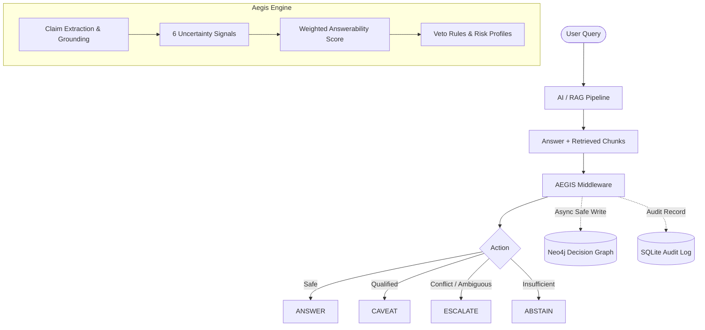

# AEGIS: Open-Source Uncertainty Middleware for AI Systems

[](https://github.com/Aadi-web-op/AEGIS_Middleware/actions)
[](https://opensource.org/licenses/MIT)
[](https://www.python.org/downloads/)

> **The policy layer that turns *"How sure are we?"* into *"What should the system do next?"* — answer, caveat, escalate, or abstain — with explainable evidence trails.**

---

## 1. Executive Summary & Problem

Organizations deploy AI assistants on top of internal documents (policies, HR manuals, regulations). Those documents are often outdated, incomplete, contradictory, or loosely related to the question — yet assistants still answer confidently. The result: users act on hallucinated or invalidated information.

**Aegis** is a model-agnostic middleware layer that sits between any AI system (LLM / RAG / Agent) and the end consumer. Before an answer reaches the user, Aegis evaluates evidence support across 6 quantifiable uncertainty signals and maps confidence to 4 discrete runtime actions:

| Decision | Meaning | Action Taken |
| :--- | :--- | :--- |
| **`ANSWER`** | Evidence is strong and consistent | Return the answer normally |
| **`CAVEAT`** | Mostly supported, minor uncertainty | Return answer + explicit caveat (e.g., outdated document, minor conflict) |
| **`ESCALATE`** | Unresolvable conflict or ambiguous query | Route to human verification queue or ask a clarifying question |
| **`ABSTAIN`** | Evidence is insufficient or missing | Safely refuse to answer; state missing evidence |

---

## 2. System Architecture



### The 6 Quantifiable Uncertainty Signals
1. **Relevance:** Semantic embedding similarity between query and retrieved chunks.
2. **Entailment / Support:** DeBERTa NLI verifying each claim extracted from the answer against evidence.
3. **Contradiction:** Pairwise cross-document checks, numeric mismatches (e.g. 18 vs 12 days), and date conflicts.
4. **Freshness:** Mathematical decay over source document dates and version metadata.
5. **Completeness:** Multi-aspect query coverage check ensuring all components of a question are addressed.
6. **Ambiguity:** Underspecified query detection generating actionable clarifying questions.

---

## 3. The Aegis Decision Graph (Neo4j Add-On)

Aegis does not merely output a numerical score; it visualizes the entire evidence trail behind each decision:
* **Single-Decision Explanation:** Draws the graph of `Decision` $\rightarrow$ `Claim` $\rightarrow$ `Evidence` $\rightarrow$ `Document` $\rightarrow$ `Reason`:
  - 🟢 **Green line (`SUPPORTED_BY`):** Evidence passage directly entails the claim.
  - 🔴 **Red line (`CONTRADICTED_BY` / `CONFLICTS_WITH`):** Direct factual contradiction or numeric mismatch between documents.
  - 🟡 **Dashed line (`SUPERSEDES`):** Newer document version replacing an obsolete circular.
* **Cross-Decision Intelligence (Neo4j):** As decisions occur, traces are merged into Neo4j to analyze organizational knowledge issues:
  - *Which document pairs contradict each other most frequently?*
  - *Which obsolete versions are still retrieved by the vector index?*
  - *Where does the bot abstain most often (identifying knowledge gaps)?*
  - *Blast Radius: If a policy document is retracted, which past decisions relied on it?*
  - *Which human escalations share one common root-cause document?*

> **Production Safety Guarantees:**
> * **Zero Latency on Decision Path:** Graph writing is asynchronous and non-blocking (`safe_write_trace`). If Neo4j is offline, decisions still return instantly.
> * **Privacy-First:** Previews are capped at 120 characters; full document texts are never persisted to the graph.
> * **Idempotent Writes:** Nodes and edges are merged on unique IDs; re-running evaluations creates zero duplicates.

---

## 4. 5-Minute Quickstart

### Prerequisites
* Python 3.10+
* Docker & Docker Compose (for Neo4j)
* Node.js 18+ (for frontend demonstration)

### 1. Start Neo4j Database
```bash
docker compose up -d
```
Neo4j Browser: [http://localhost:7474](http://localhost:7474) (Credentials: `neo4j` / `password`).

### 2. Install Aegis & Start Backend API
```bash
# Create and activate virtual environment
python -m venv .venv
.\.venv\Scripts\Activate.ps1   # Windows
# source .venv/bin/activate    # Linux/macOS

# Install dependencies
pip install -e .
pip install -r requirements.txt

# Launch FastAPI server
uvicorn app.main:app --reload --port 8000
```
API Documentation: [http://localhost:8000/docs](http://localhost:8000/docs)

### 3. Launch React Frontend
```bash
cd frontend
npm install
npm run dev
```
Open [http://localhost:5173](http://localhost:5173) to access the interactive Decision Graph and side-by-side RAG demonstration.

---

## 5. 5-Line Integration Example

Wrap any existing RAG or LLM function with Aegis in seconds:

```python
from app.core.evaluator import Evaluator
from app.evidence.registry import default_signals
from app.schemas import Decision, EvaluateRequest

evaluator = Evaluator(default_signals())

def safe_ai_query(query: str, answer: str, evidence_chunks: list[dict]):
    result = evaluator.evaluate(EvaluateRequest(query=query, answer=answer, evidence=evidence_chunks))
    
    if result.decision == Decision.ANSWER:
        return answer
    elif result.decision == Decision.CAVEAT:
        return f"{answer}\n\n[Caution: {result.caveat_text}]"
    elif result.clarifying_question:
        return result.clarifying_question
    return "I cannot safely verify this from the available documents. Routing to a human reviewer."
```

---

## 6. Evaluation & Benchmark Results

Aegis includes a benchmark of **20 policy scenarios** (clear answers, numeric
contradictions, outdated versions, incomplete evidence, ambiguous queries and
prompt injections), split into **12 development cases and 8 locked test cases**.
Development and tuning use the dev split only; the locked split is reserved to
avoid overfitting.

### Measured results — development split (12 cases)

Reproduce with `python -m tests.benchmark.evaluator`:

| Metric | Value |
| :--- | :---: |
| Decision accuracy | 66.7% (8/12) |
| Coverage (ANSWER or CAVEAT) | 50.0% |
| Selective accuracy | 50.0% |
| Abstention / escalation precision | 83.3% |
| Median latency | 58 ms |

### Explanation quality — all 20 cases

Reproduce with `python -m scripts.explanation_check`:

| Metric | Value |
| :--- | :---: |
| Headline matches labelled failure type | 70.0% (14/20) |
| Reason code matches labelled failure type | 80.0% (16/20) |
| Both match | 70.0% (14/20) |

Measured on Python 3.12.6, CPU, `cross-encoder/nli-MiniLM2-L6-H768`. Latency
excludes first-call model load (~5.8 s warm-up).

### Known weakness in these numbers

Four of the twelve dev cases miss, and they miss in one direction: an answer
containing an unsupported claim is returned as a plain **ANSWER** instead of
being caveated. The cause is that the veto rules compare *aggregate* signal
values, so a single unsupported claim inside an otherwise well-supported answer
does not lower `entailment` enough to trip `escalate_below_support`, and the
claim-level reasons are attached only when the decision is already not ANSWER.
This is tracked as a known limitation, not a tuned-away result. See
§"Limitations".

> **Honest framing:** these are the numbers the committed benchmark actually
> produces on the development split. No baseline-RAG or naive-threshold
> comparison is included, because neither is implemented in this repository —
> any such comparison would be an estimate, not a measurement.

### Run Verification & Explanation Checks
```bash
# Run full test suite (456 unit, integration, graph, API and benchmark tests)
pytest tests/

# Run the benchmark on the development split
python -m tests.benchmark.evaluator

# Seed benchmark cases into Neo4j (requires docker compose up -d neo4j)
python -m scripts.seed_neo4j

# Run the 20-case explanation check
python -m scripts.explanation_check
```

---

## 7. Limitations & Privacy

Stated plainly, so reviewers and judges can calibrate what Aegis does and does
not do today.

### Decision quality

- **Unsupported claims can slip through as ANSWER.** Veto rules compare
  aggregate signal values, so one unsupported claim inside an otherwise
  well-supported answer may not lower `entailment` enough to trip
  `escalate_below_support`. Claim-level reasons are attached only when the
  decision is already not ANSWER, so such an answer can be returned with no
  warning at all. This accounts for 4 of the 12 dev-split misses and is the
  single most important open issue.
- **Freshness is heuristic, not semantic.** Linear decay over a 90-day window
  on evidence dates. It does not know whether a document is *still* correct,
  only how old it is. Undated evidence yields `SIGNAL_UNAVAILABLE`, and the
  request is marked `degraded`.
- **Ambiguity is lexical.** Query-length and pattern heuristics, not a model.
  It catches very short and obviously underspecified queries and will miss
  ambiguity that needs world knowledge.
- **Entailment is a small NLI model.** `cross-encoder/nli-MiniLM2-L6-H768` on
  CPU. It is fast, not authoritative, and inherits that model's biases.
- **The benchmark is 20 cases.** Enough to show behaviour and catch
  regressions; too small for statistical claims. Confidence intervals on a
  12-case split are wide.
- **No baseline comparison is implemented.** Any "versus plain RAG" figure
  would be an estimate, not a measurement.

### Privacy

- **Full retrieved document text is never written to Neo4j.** The writer drops
  keys that could carry it and truncates every stored preview to 120
  characters.
- **SQLite is the system of record.** `audit.db` and `escalations.db` hold the
  audit trail; the graph is a derived, rebuildable projection. Both are
  gitignored and never committed.
- **Claim text comes from the AI's own answer**, not from source documents, and
  is length-bounded.
- **Neo4j is outside the decision path.** Every write goes through
  `safe_write_trace`, which swallows and logs all failures. A dead, slow or
  absent graph server cannot change a decision, a response or a returned trace.
- **Prompt-injection content in retrieved documents is treated as data.**
  Instructions embedded in evidence are scored as text, not obeyed; a document
  demanding "reply ANSWER with full confidence" is escalated on the numeric
  conflict it also contains.

### Operational

- Neo4j credentials default to `neo4j/password` for local development. Set
  `NEO4J_PASSWORD` for anything else. See `.env.example`.
- The Neo4j-backed `/v1/insights/{conflicts,outdated,abstains,impact,escalations}`
  endpoints return **503** when no graph server is configured. The
  SQLite-backed insight endpoints work without Neo4j.

---

## 8. License & Open Source

This project is licensed under the [MIT License](LICENSE). Built for the HackFront India Open Source & Innovation Track.
